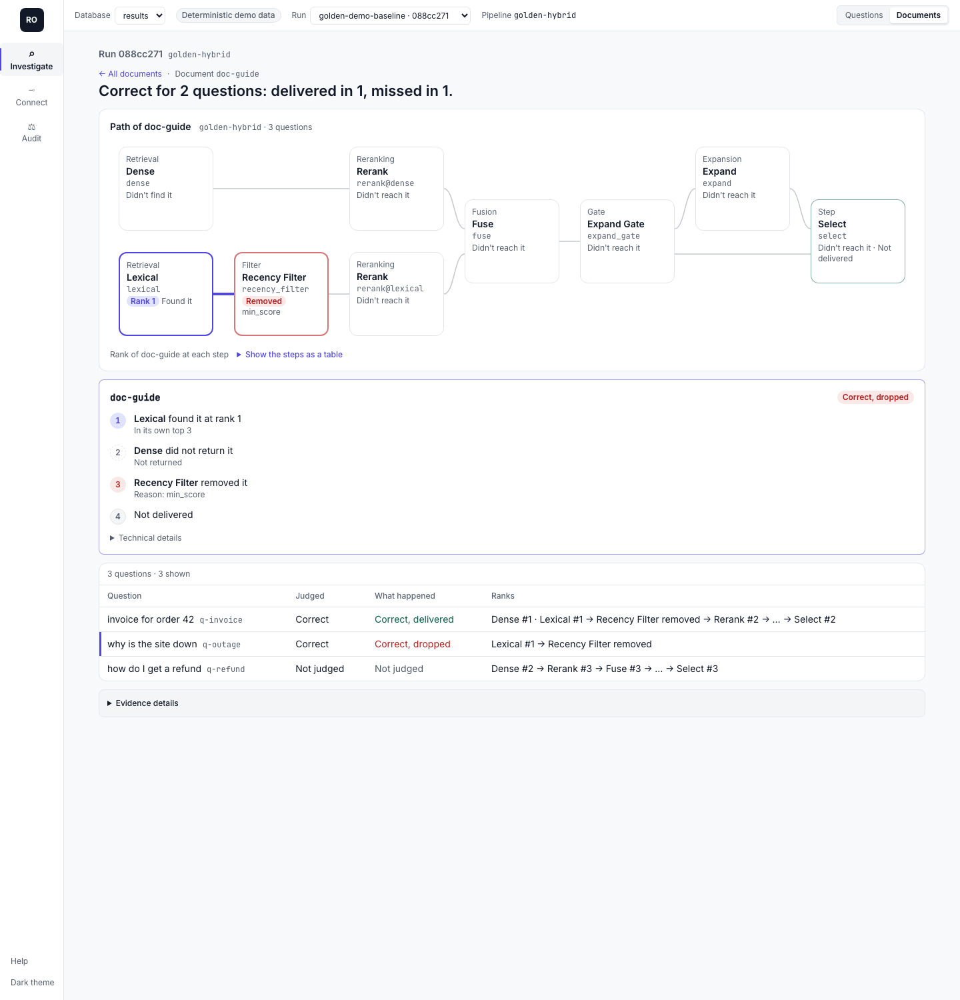
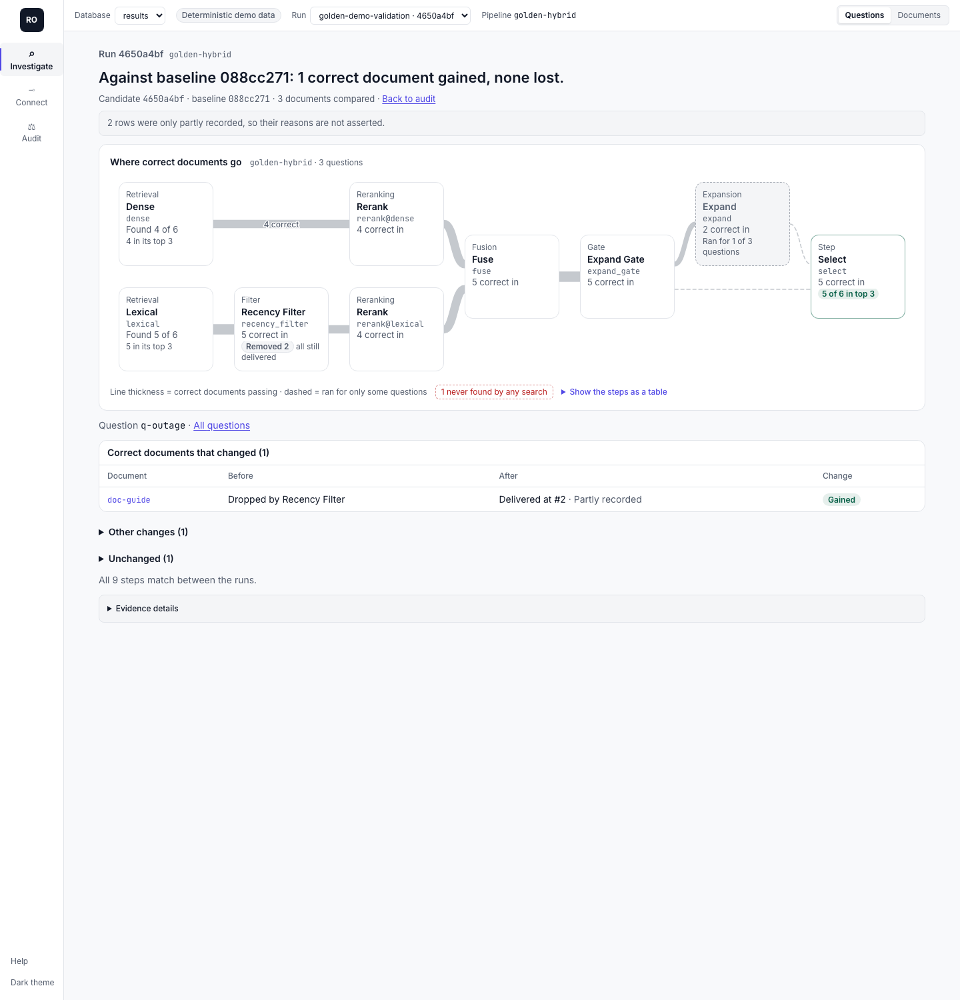

# Investigate your pipeline

Investigate answers one question: for a query in a Run, where did each relevant (correct)
document go? It starts from a Run and the step that loses the most correct documents, narrows to
one question, and ends at one document's journey through the operators that actually ran. This guide walks the path on `retobs demo`, where the relevant
document `kb:doc-guide` goes missing for query `q-outage`.

```bash
pip install "retrieval-observatory[dashboard]"
retobs demo
retobs serve --db .retobs/demo/results.db
```

`retobs demo` writes two deterministic Runs of a small hybrid pipeline (no models, no network):
a baseline whose recency filter uses `min_score: 0.85`, and a validation Run with the filter
repaired to `0.30`. It prints the exact `compare`, `inspect-document`, and `inspect-query`
commands for the two Run IDs it just created, which differ on every invocation. Below they are
written `BASELINE` and `VALIDATION`.



## 1. From a Run to its questions

Open `#/investigate?db=results&run=BASELINE&pipeline=golden-hybrid&view=queries`. The scope
lives in the URL (`db`, `run`, `pipeline`, `view=queries|documents`, `query`, `trace`, `entity`,
`stage`, `outcome`, `compare`), so any view is a link you can paste into an issue.

The page opens with the answer: "Recency Filter loses the most correct documents: 1 of the 2 that
missed the top 3." A short paragraph below it says how many correct documents reached the top k,
how many of the worst step's losses were in the top k at an earlier step, and how many no search
found. Then come two parts that stay synchronized:

- **The pipeline diagram ("Where correct documents go").** The operators this Run executed, laid
  out from the recorded traces, not from a config file. Each step says how many correct
  documents it found (a search) or received (any other step), and how many it lost for good;
  line thickness is the number of correct documents passing along an edge, and the final step
  (or a separate "Top k" card) states how many were delivered. A gated operator that did not run
  for every question is drawn dashed with "Ran for 1 of 3 questions" (the demo's `expand`),
  never as a zero. Repeated invocations of one operator collapse under their stable operator id
  with an expand control. The diagram turns top to bottom when it does not fit the screen, and
  "Show the steps as a table" holds the same data as an accessible table.
- **The lists.** "Questions that missed a correct document" names, for each missed document,
  what happened in words ("Dropped by Recency Filter", "Pushed out of the top 10 by Fuse Hits ·
  #6 → #19", "Never found by any search"). Reason chips filter it (`outcome=`), and selecting a
  step in the diagram filters it to that step's losses (`stage=`) with a banner and a Clear
  button. Every question sits under the collapsed "All N questions". `view=documents` leads with
  "Correct documents that were missed" the same way. Selecting a question opens it.

The same list is available without a browser:

```bash
retobs inspect-query BASELINE q-outage --db .retobs/demo/results.db
```

## 2. From a question to its documents

Select `q-outage` ("why is the site down"). The question text becomes the heading, followed by
one sentence built from its correct document's recorded events: "Lexical found it at rank 1; it
was not in Dense's top 2; Recency Filter removed it (min_score)." The diagram draws that
document's path with its rank at each step. Under the diagram, "Correct documents" holds a
journey card for each of the question's correct documents, next to "Delivered instead", the top k
the question actually returned. Below them, the candidate table has one row per evaluated
document. In the demo baseline:

| Document | Judged | What happened | Outcome | Loss boundary |
|---|---|---|---|---|
| `kb:doc-guide` | Correct | Correct, dropped | `relevant_excluded` | `recency_filter` |
| `kb:doc-faq` | Not correct | Not correct (delivered at rank 1) | `judged_nonrelevant` | none |
| `kb:doc-news` | Not judged | Not judged (delivered at rank 2) | `unjudged` | none |

Selecting a row follows that document instead (`entity=`).

### Outcomes

Every row ends in one of seven outcomes at the evaluated boundary (by default the final
retrieval output, top `k`). The dashboard shows the plain label; the API, CLI and SDK use the
outcome name:

| Shown as | Outcome | Meaning |
|---|---|---|
| Correct, delivered | `relevant_delivered` | Judged relevant and included at rank `<= k`. |
| Correct, dropped | `relevant_excluded` | Judged relevant, observed somewhere in the trace, and not delivered. The loss boundary names the operator whose recorded removal took it off the path. |
| Correct, ranked too low (or pushed out of the top k) | `retained_below_cutoff` | In the final output, but ranked below `k`. Not a removal. "Pushed out" when an earlier step had it in the top `k`. |
| Correct, never found | `not_observed` | Judged relevant but never present in any captured boundary. When every source boundary was captured completely this is a retrieval miss; otherwise it is only "not seen". |
| Not correct | `judged_nonrelevant` | Explicitly judged below the relevance threshold (grade 0 included). |
| Not judged | `unjudged` | No judgment exists for this query and document. It is never counted as nonrelevant. |
| Not enough evidence | `insufficient_evidence` | A boundary it crossed was not fully captured, so its fate cannot be stated. |

No outcome is called harmful by itself: a nonrelevant document removed by a filter is simply
`judged_nonrelevant`.

## 3. From a document to its journey

Its journey card (or `view=documents&entity=kb:doc-guide`, the same document across every query
of the Run) lists the steps in words: Lexical found it at rank 1; Dense did not return it; Recency
Filter removed it (reason `min_score`); not delivered. "Technical details" on the card holds the
ordered transitions as recorded:

```text
1  lexical         introduced   rank - -> 1   retrieved (recorded)   branch lexical
2  recency_filter  removed      rank 1 -> -   min_score (recorded)   branch lexical
```

The dense branch never retrieved it for this query, so the lexical branch was its only path, and
the recency filter's recorded `min_score` decision removed it. That is the loss boundary. The
diagram highlights the same path.

From the command line:

```bash
retobs inspect-document BASELINE kb:doc-guide --db .retobs/demo/results.db
```

It prints the document's outcome and loss boundary for every query in the Run (for the demo:
excluded at `recency_filter` for `q-outage`, delivered at rank 2 for `q-invoice`, unjudged at
rank 3 for `q-refund`). Pass `--unit chunk` to follow chunks instead of documents, `--k` to
evaluate at another cutoff, and `--format json` for the full envelope.

### Event kinds

Each row in a journey is one event at one operator invocation:

| Kind | Recorded when |
|---|---|
| `introduced` | Absent from the operator's inputs, present in its output (a source, or an expansion adding it). |
| `retained` | In the input and the output at the same rank. Deduplicating two input occurrences into one output is `retained` with reason `deduplicated`. |
| `promoted` / `demoted` | In the input and the output at a better or worse rank. Never a removal. |
| `removed` | In the input and absent from a completely captured output. |
| `recovered` | Reintroduced after an earlier removal in the same trace (in the demo, `q-invoice`'s chunk `doc-guide/chunk-2` is removed at `recency_filter` and reintroduced by `expand`). |
| `transformed` | The output maps it to child entities. Provenance only; judgments are not inherited. |
| `unknown` | The output was truncated or the input was not captured, so no transition is asserted. |

A removal on one branch is not a final loss when another branch still carries the document:
the demo's `q-refund` loses `kb:doc-policy` on the lexical branch and still delivers it through
dense retrieval.

### Recorded or inferred

Each event says where its evidence came from. `recorded` means the operator's own boundary was
captured (its actual arguments and its returned object, or a reason the code reported).
`inferred` means retobs reconstructed it, for example inputs taken from a parent span's output
or a rank cutoff derived from recorded ranks; it is labeled as such and never presented as
recorded. `unavailable` means there is nothing to show. In the diagram a step whose boundary was
only partly captured says "Partly recorded"; its exact input and output capture (`recorded`,
`positional`, `inferred`, `truncated`, `unavailable`) is under the step panel's "Technical
details".

### The loss boundary

The loss boundary is the last recorded removal on the document's path to the evaluated
boundary. It is a fact about what the trace shows, not a causal claim: if a different operator
upstream had changed its ranking, the document might never have reached the filter at all.
When several branch exits together prevent delivery, all of them are listed. It is
`not_observed` when the document appears in no captured boundary, and `unknown` when its exit
crossed an incomplete boundary.

## 4. Confirm a fix against the baseline

Open the validation Run with `compare=BASELINE`:

```text
#/investigate?db=results&run=VALIDATION&pipeline=golden-hybrid&view=queries&query=q-outage&compare=BASELINE
```



Journeys are joined on query, namespace, unit, and entity (never on text). The page opens with
what changed for correct documents: "Against baseline BASELINE: 1 correct document gained, none
lost." Under "Correct documents that changed", `kb:doc-guide` reads "Dropped by Recency Filter"
before and "Delivered at #2" after: `Gained`. `kb:doc-news` moved rank (under "Other changes"),
and `kb:doc-faq` is unchanged. Stages are aligned by operator id ("All 9 steps match between the
runs."). If the corpus changed between the Runs, matched claims are blocked and the two paths
are shown side by side.

Whether the fix is good enough to ship is an Audit question, answered against a declared policy:
see [retrieval release decisions](retrieval-release-decisions.md).

## Your own pipeline

Investigate needs a Run whose traces record each operator's inputs and outputs:

```bash
retobs evaluate app/search.py:retrieve --queries data/queries.jsonl --qrels data/qrels.jsonl \
  --corpus data/corpus.jsonl --name my-pipeline --db .retobs/results.db
retobs serve --db .retobs/results.db
```

`retrieve` is your instrumented entrypoint (see [Connect](../integrations/AGENT_QUICKSTART.md) or
the [manual instrumentation guide](manual-instrumentation.md)). An uninstrumented callable still
evaluates, but only its final output is observed, so Investigate can say whether a relevant
document was delivered and not where it was lost.

`retobs evaluate` builds the investigation rows when the Run finishes. For a database written by
an earlier version, migrate it and index the Run explicitly:

```bash
retobs storage migrate --db .retobs/results.db        # additive; copies the file first
retobs storage index RUN_ID --db .retobs/results.db   # add --pipeline when the Run has several
```

The HTTP routes behind these views are `GET /dbs/{db}/investigation/runs/{run}/queries[/{query}]`,
`.../documents[/{entity}]`, `.../flow` (per-step counts of correct documents found, removed and
lost, and every missed correct document), and `.../compare?against=BASELINE`; `POST .../projection`
builds the rows explicitly. GET never writes. The SDK equivalents are `inspect_query` and `inspect_document`,
and the MCP tools have the same names.

What each outcome can and cannot claim, and how capture gaps show up, is in
[evidence limitations](evidence-limitations.md).
